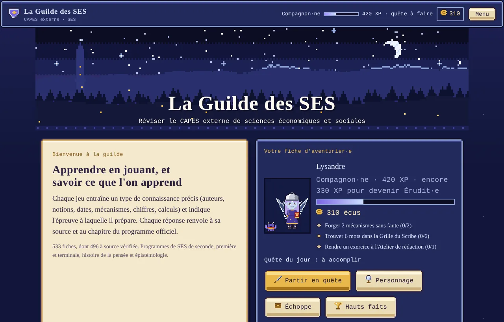
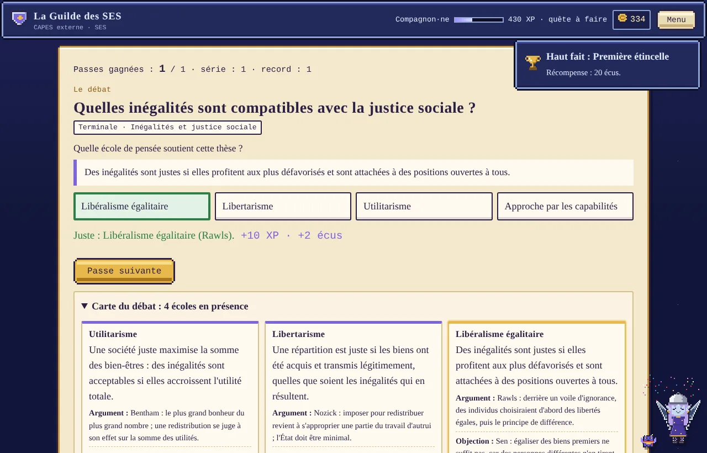
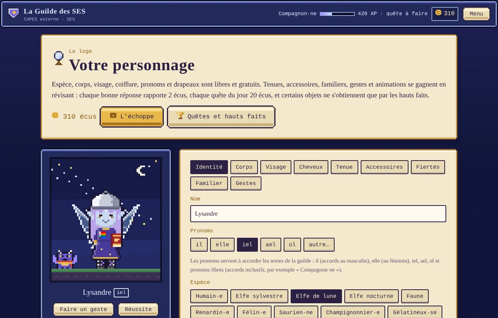
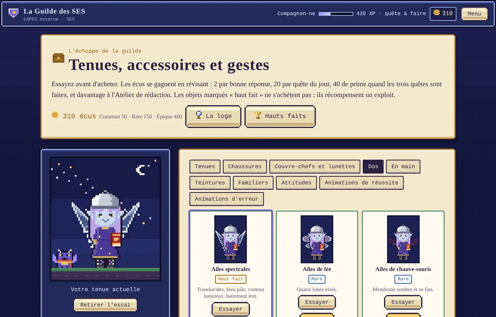
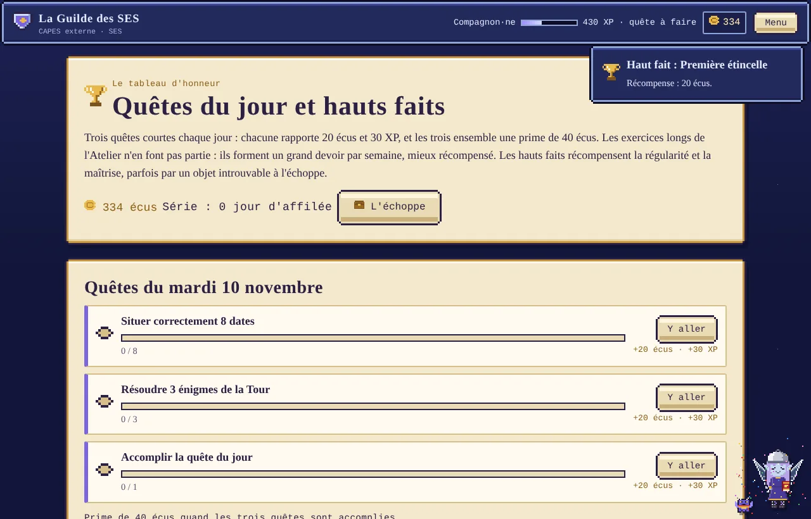
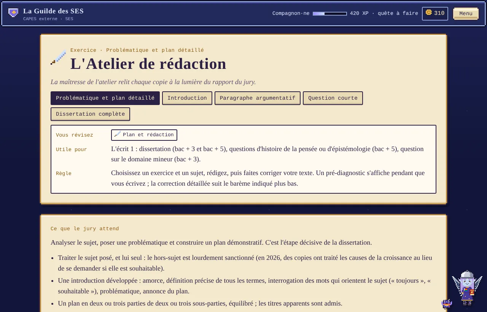

# 🧝 La Guilde des SES

**Réviser le CAPES externe de sciences économiques et sociales en jouant, en sachant toujours ce que l'on apprend et où.**

Pensé pour un niveau concours : relier un auteur à son œuvre et à sa thèse, distinguer des notions voisines, opposer des écoles de pensée, enchaîner un mécanisme, lire un tableau sans contresens. Chaque réponse renvoie à sa source, en un clic. Un personnage en pixel art à composer, des quêtes du jour, un grand devoir par semaine, une échoppe, et un atelier pour s'entraîner à la dissertation et aux questions de l'écrit 1.

## 👉 [Jouer maintenant : babash.github.io/guilde-ses](https://babash.github.io/guilde-ses/)

**Gratuit · sans compte · rien à installer · aucune donnée personnelle**

---

## Ce que l'on révise

| Savoir | Contenu | Jeux |
|---|---|---|
| **Débats et écoles de pensée** | 28 débats, 100 positions | **La Joute des écoles** (jeu phare) : qui défend cette thèse, quelle objection la touche, quel plan thèse-antithèse-dépassement ; la Chronique (généalogie d'un débat) |
| **Auteurs, œuvres et thèses** | 239 fiches | Trois Sceaux (auteur, œuvre, notion), Bibliothèque (rendre à chaque auteur ses thèses et ses œuvres), Énigme de la Tour, Faussaire, mots fléchés |
| **Notions et définitions** | 176 fiches | Notions jumelles (distinguer chômage, sous-emploi et halo…), mots fléchés à indices courts |
| **Mécanismes** | 25 fiches | La Forge : ordonner la chaîne, trouver le maillon faux ; hypothèses et limite de chaque mécanisme |
| **Dates et repères** | 52 fiches | Duel des Âges (une œuvre avant ou après un événement), Chronique d'un chapitre, repères d'un chapitre |
| **Chiffres clés** | 48 fiches | La Balance : des fausses valeurs de plus en plus proches de la vraie |
| **Données quantitatives** | à volonté | Le Comptoir : calculs de niveau concours (contribution à la croissance, rapport des chances, D9/D1…) et lecture de tableaux (destinée ou recrutement, points ou %) |
| **Plan et rédaction** | 116 sujets | L'Atelier de rédaction ; un grand devoir par semaine |

Les pièges sont plausibles : les fausses réponses viennent du même chapitre, du même courant ou de la même époque que la bonne, comme les confusions que relève le jury. Chaque jeu dit ce qu'il fait réviser et pour quelle épreuve. Les fiches sont rangées par chapitre du programme officiel de seconde, première et terminale, plus l'histoire de la pensée et l'épistémologie (programme du concours). Une **quête du jour** de 7 questions mélange tout, avec une série de jours d'affilée.

**Sources : les 540 fiches sont vérifiées une à une** sur une source consultable en ligne (éditeurs, revues, Insee, Banque de France, BO, Wikipédia, cours universitaires). Les fiches auteurs et mécanismes, et les notions les plus récemment sourcées, indiquent en plus **le passage précis à lire** : une citation courte et un lien qui ouvre la source sur cette phrase (ou sur la bonne page d'un PDF). Les chiffres clés datent de novembre 2026.

| | |
|---|---|
|  **La Joute des écoles** : après chaque passe, la carte du débat, ses écoles, leurs objections et un plan dialectique. |  **La loge** : 12 espèces, visages, coiffures, tenues, familiers. |
|  **L'échoppe** : tenues, accessoires, gestes et animations, à essayer avant d'acheter. |  **Quêtes et hauts faits** : trois quêtes courtes par jour, un grand devoir par semaine, seize exploits. |

## Votre personnage

Nom, pronom, espèce (humain·e, elfes, faune, renardin·e, félin·e, saurien·ne, champignonnier·e, gélatineux·se, golem de mousse, spectre), corps, visage et coiffure sont libres et gratuits. Les textes s'adressent à vous selon le pronom choisi, en écriture inclusive s'il n'est pas précisé.

Tenues, accessoires, familiers, gestes et animations de réussite ou d'erreur se gagnent en révisant : 2 écus par bonne réponse, 20 par quête du jour, 40 de prime pour les trois, 150 pour le grand devoir de la semaine (une dissertation complète deux semaines sur trois, une question courte la troisième). Certains objets, comme les ailes spectrales ou le Bottin mondain, récompensent un haut fait. Pendant les jeux, le personnage et son familier réagissent à vos réponses.

## L'Atelier de rédaction, avec l'IA de votre choix

Cinq exercices : **problématique et plan**, **introduction**, **paragraphe argumentatif**, **question courte**, **dissertation complète**. 86 sujets réels du concours (2000-2026) et les 30 questions du programme, chacun avec sa source.

1. Pendant que vous écrivez, un **pré-diagnostic** s'affiche : longueur, plan repéré, problématique, termes du sujet oubliés, auteurs reconnus et **noms propres mal orthographiés** (« Shumpeter » → Schumpeter).
2. Le site prépare une **consigne de correction complète** : attentes du rapport du jury 2026, barème de l'exercice, repères de notation, fiches utiles et votre copie.
3. Vous la donnez à **l'IA de votre choix** (ChatGPT, Claude, Le Chat, Gemini…), puis vous collez sa réponse : le site affiche la note, le détail par critère, les erreurs relevées, le plan attendu et les fiches à revoir, avec leurs sources.

Le site n'appelle aucune IA lui-même et ne demande aucune clé.

## Sauvegarde

La progression est gardée dans le navigateur. Pour la retrouver sur un autre appareil, la page **Sauvegarde** crée un **code secret** de 16 caractères, sans compte ni e-mail. La base Supabase n'en conserve que l'empreinte (SHA-256) ; la progression s'envoie toute seule quelques secondes après chaque changement.

## Installer votre propre copie

1. **Forkez** ce dépôt et activez **GitHub Pages** (Settings → Pages → branche `main`, dossier `/`).
2. Pour la sauvegarde en ligne : créez un projet [Supabase](https://supabase.com) (ou réutilisez-en un : tout est préfixé `guilde_`), lancez [`supabase.sql`](supabase.sql) dans *SQL Editor*, puis recopiez l'URL du projet et la clé publique (*publishable key*) dans [`js/config.js`](js/config.js). Sans cela, le site fonctionne, la progression reste dans le navigateur.

Pour modifier le contenu, éditez les fichiers de [`donnees/`](donnees) puis lancez `python3 outils/construire.py`. Les détails sont dans [docs/ARCHITECTURE.md](docs/ARCHITECTURE.md).

## Licence

[CC BY-SA 4.0](LICENSE). Les sujets cités appartiennent à leurs auteurs (ministère de l'Éducation nationale, jurys du CAPES) et renvoient à leurs sources.
